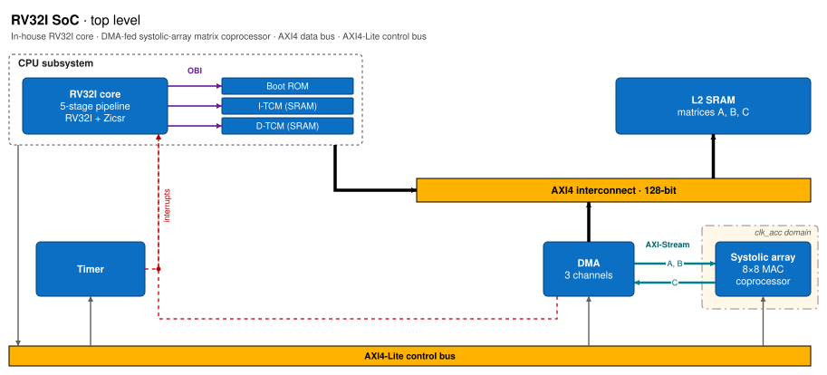

# riscv32-ext-coprocessor

Design and RTL implementation of a RISC-V SoC for an ASIC: an in-house RV32I core and a
systolic-array matrix multiplication coprocessor. The core configures the coprocessor and a DMA
through memory-mapped registers, and the DMA streams the matrices between the L2 SRAM and the array.



## Specification

Each part of the design is specified in the README next to its RTL:

| Topic | Contents |
|---|---|
| [SoC](rtl/top/README.md) | Memory map, matrix buffers in L2, interrupts, clocks, interfaces between blocks |
| [Core](rtl/core/README.md) | Instructions, CSRs, traps, ports |
| [DMA](rtl/dma/README.md) | Channels, registers, ports |
| [Coprocessor](rtl/coproc/README.md) | Operation, matrix layout, registers, ports |
| [Timer](rtl/periph/README.md) | Registers |
| [Software](sw/README.md) | Toolchain, boot, matrix multiplication sequence from the core |

Diagrams are in [`docs/figures/`](docs/README.md#figures).

## Milestones

| Milestone | Scope | Status |
|---|---|---|
| `v0.1.0` | Specification: memory map, interfaces, register maps, core instructions and CSRs | In progress |
| `v0.2.0` | RV32I core passes `riscv-tests` in simulation | Planned |
| `v0.3.0` | DMA and coprocessor verified at block level (UVM) | Planned |
| `v0.4.0` | Integrated SoC runs matrix multiplications in simulation | Planned |
| `v0.5.0` | ASIC synthesis: area and maximum frequency | Planned |

## Repository layout

| Directory | Contents |
|---|---|
| [`rtl/`](rtl/README.md) | Synthesizable SystemVerilog and the block specifications: core, coprocessor, DMA, interconnect, memories, timer, SoC top |
| [`vendor/`](vendor/README.md) | Third-party IP, unmodified (git submodules) |
| [`verif/`](verif/README.md) | UVM environments, unit testbenches, reference models, assertions, regression lists |
| [`sw/`](sw/README.md) | RISC-V programs that run on the core (tests, matmul kernels) |
| [`syn/`](syn/README.md) | ASIC synthesis inputs: timing constraints, flow scripts |
| [`docs/`](docs/README.md) | Verification plan, guides, figures |
| [`scripts/`](scripts/README.md) | Tool wrappers and helper utilities |
| `build/` | All generated output (git-ignored, created on demand) |

## Quick start

```bash
git clone --recurse-submodules git@github.com:Felipe-Freire/riscv32-ext-coprocessor.git
cd riscv32-ext-coprocessor
source scripts/setup.sh   # exports PROJ_ROOT
make help                 # list available targets
```

### Prerequisites

| Tool | Purpose |
|---|---|
| SystemVerilog/UVM simulator | UVM simulation (to be defined) |
| RISC-V GNU toolchain (`riscv64-unknown-elf-gcc`) | Building programs in [`sw/`](sw/README.md) |
| ASIC synthesis tool and PDK | Synthesis in [`syn/`](syn/README.md) (to be defined) |

Detailed setup instructions will live in [`docs/guides/`](docs/README.md#guides).

## Documentation

Start at the [documentation index](docs/README.md).

## License

To be defined.
