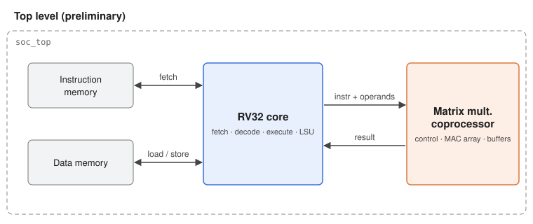

# riscv32-ext-coprocessor

Design and RTL implementation of a 32-bit RISC-V core with a coupled matrix multiplication coprocessor.



## Status

| Milestone | Scope | Status |
|---|---|---|
| `v0.1.0` | Repository skeleton, lint CI | In progress |
| `v0.2.0` | RV32I core passes `riscv-tests` | Planned |
| `v0.3.0` | Coprocessor verified at block level (UVM) | Planned |
| `v0.4.0` | Integrated system runs matmul kernels through custom instructions | Planned |

## Repository layout

| Directory | Contents |
|---|---|
| [`rtl/`](rtl/README.md) | Synthesizable SystemVerilog: core, coprocessor, integration top |
| [`verif/`](verif/README.md) | UVM environments, reference models, assertions, regression lists |
| [`sw/`](sw/README.md) | RISC-V programs that run on the core (tests, matmul kernels) |
| [`docs/`](docs/README.md) | Specifications, verification plan, guides, design decisions, figures |
| [`scripts/`](scripts/README.md) | Tool wrappers, lint configuration, helper utilities |
| `build/` | All generated output (git-ignored, created on demand) |

## Quick start

```bash
git clone git@github.com:Felipe-Freire/riscv32-ext-coprocessor.git
cd riscv32-ext-coprocessor
source scripts/setup.sh   # exports PROJ_ROOT
make help                 # list available targets
```

### Prerequisites

| Tool | Purpose |
|---|---|
| SystemVerilog/UVM simulator | UVM simulation (to be defined) |
| RISC-V GNU toolchain (`riscv64-unknown-elf-gcc`) | Building programs in [`sw/`](sw/README.md) |
|.....|.....|

Detailed setup instructions will live in [`docs/guides/`](docs/README.md#guides).

## Documentation

Start at the [documentation index](docs/README.md). Design decisions are recorded as short
[ADRs](docs/decisions/) — read them before changing an established convention.

## License

To be defined.
