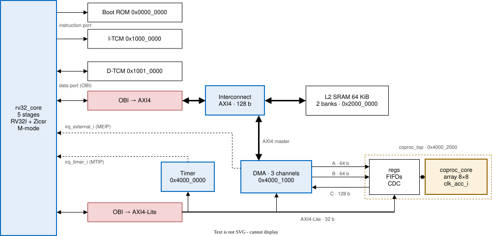
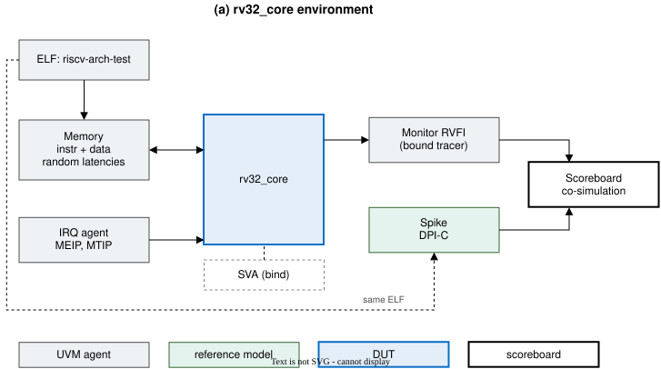
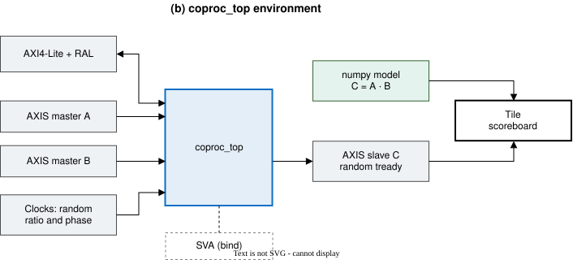
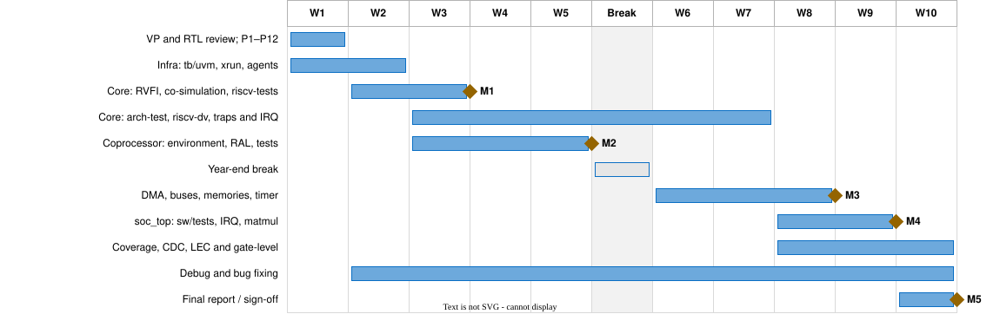

# Verification Plan — riscv32-ext-coprocessor SoC

**RV32I core, 8×8 systolic coprocessor, DMA and buses**

riscv32-ext-coprocessor project team <!-- TODO: names of the team members. -->
CEPEDI — CI Digital · Digital Systems Skills Development Program

| Document | Verification Plan |
|----------|-------------------|
| Version  | 0.2 |
| Date     | 14/11/2026 |
| Baseline | Project files (`rtl/core`, `rtl/coproc`, `rtl/dma`, `rtl/top` ...) as of 14/11/2026 |

> The figures are in [`figures/`](figures/) in draw.io format and can be edited in diagrams.net or in the Draw.io extension for VS Code.

## Table of contents

1. [Introduction](#1-introduction)
   1. [Project overview](#11-project-overview)
   2. [DUT description](#12-dut-description)
   3. [Verification goals and targets](#13-verification-goals-and-targets)
   4. [Current status](#14-current-status)
   5. [Environment and tools](#15-environment-and-tools)
2. [Test plan](#2-test-plan)
   1. [Features to be verified](#21-features-to-be-verified)
   2. [Stimulus strategies](#22-stimulus-strategies)
   3. [Coverage model](#23-coverage-model)
   4. [Summary of planned tests](#24-summary-of-planned-tests)
3. [Preliminary schedule](#3-preliminary-schedule)
4. [References](#references)

## Revision history

| Version | Date | Description |
|---------|------|-------------|
| 0.1 | 13/11/2026 | Initial version: introduction, DUTs, targets, test plan, coverage and preliminary schedule. |
| 0.2 | 14/11/2026 | Document refactoring to make it more readable. Correction of the models to match the current state of the project. |

---

## 1. Introduction

### 1.1 Project overview

The project is an ASIC SoC that combines a RISC-V host processor, a DMA and an accelerator that performs a single computation: C = A · B, with A and B in int8 and C in int32. The work is split among three blocks, each with a single function:

- **RV32I core** (`rv32_core`): in-house five-stage processor, RV32I + Zicsr, machine mode only. It runs the program, configures the DMA and the coprocessor through memory-mapped registers and handles interrupts. It has no custom instructions.
- **3-channel DMA**: reads A and B from the L2 memory over 128-bit AXI4 and delivers them as AXI4-Stream streams; receives C and writes it to the L2.
- **Coprocessor** (`coproc_top`): 8×8 output-stationary systolic array, 64 int8 MACs per cycle, in its own clock domain (`clk_acc_i`). It has no addresses: it consumes the streams in the order they arrive.

Traffic is split into three planes: control (32-bit AXI4-Lite), data (128-bit AXI4 and streams) and events (interrupts). The interconnect comes from the PULP `axi` library (v0.39.11) and from `common_cells` (v1.39.0), in `vendor/`. The core RTL is already going through synthesis in Cadence Genus, which also feeds the area × fmax comparative study.

Unlike a project with a single algorithm, this SoC does not have a single reference model. Verification relies on three:

1. **Spike**, the official RISC-V simulator, for the core, instruction by instruction (co-simulation);
2. A *golden model* to validate matrix multiplication with int32 arithmetic with *wrap-around*, for the coprocessor;
3. SystemVerilog transaction models for the DMA, the buses and the registers (address predictor and UVM register model, the RAL).

### 1.2 DUT description

[Figure 1](#fig-soc) shows the SoC and [Table 1](#tab-levels) the three levels at which it is verified. Each block enters the SoC only after passing in its own environment.

**Figure 1 —** SoC overview. Blue: in-house RTL blocks; red: OBI→AXI bridges; amber: the array's clock domain, which only `coproc_top` crosses; dashed: interrupts. Thick lines are 128-bit AXI4.

**Table 1 —** Verification levels, DUTs and environments.

| Level | DUTs | Environment |
|-------|------|-------------|
| L1 Unit | Core: `rv32_alu`, `rv32_decoder`, `rv32_imm_gen`, `rv32_regfile`, `rv32_hazard`, `rv32_branch_pred`, `rv32_pc`, `rv32_csr`, `rv32_load_align`, `rv32_store_align`. Coprocessor: `coproc_mac`, `coproc_pe`, `coproc_skew`, `coproc_pe_array`. Memories: Boot ROM, I-TCM, D-TCM, L2. | Directed SystemVerilog testbenches (`tb_rv32_*`, `tb_mac`). |
| L2 Block | `rv32_core`; `coproc_top`; `dma_core`; timer; OBI→AXI4 and OBI→AXI4-Lite bridges with the interconnects. | One UVM environment per block in `tb/uvm/`, with reusable agents (OBI, AXI4, AXI4-Lite, AXI4-Stream, IRQ (Interrupt Request)) and the block's reference model. |
| L3 System | `soc_top`. | C and assembly programs from `sw/tests` loaded into the memories; passive monitors from the block environments, Spike co-simulation. |

**Table 2 —** Address map: what each port sees.

| Base | Size | Region | Fetch | `lw`/`sw` | DMA | Path |
|------|------|--------|:-----:|:---------:|:---:|------|
| `0x0000_0000` | 4 KiB  | Boot ROM, reset vector | ● | — | — | instruction port |
| `0x1000_0000` | 32 KiB | I-TCM: program | ● | — | — | instruction port |
| `0x1001_0000` | 32 KiB | D-TCM: data, stack, `.rodata` | — | ● | — | direct OBI, 1 cycle |
| `0x2000_0000` | 64 KiB | L2 SRAM: A, B and C | — | ● | ● | OBI→AXI4 |
| `0x4000_0000` | 4 KiB  | Timer registers | — | ● | — | OBI→AXI4-Lite |
| `0x4000_1000` | 4 KiB  | DMA registers | — | ● | — | OBI→AXI4-Lite |
| `0x4000_2000` | 4 KiB  | Coprocessor registers | — | ● | — | OBI→AXI4-Lite→CDC |

Any other address: access fault (`mcause` 1 on fetch, 5 on a load, 7 on a store).

#### 1.2.1 Core

Classic IF, ID, EX, MEM, WB pipeline, with two ports (instruction and data). IF/ID has no instruction register: the instruction memory holds its output while `instr_req_o` is 0, and `instr_req_o = ~stall`. ID reads the register file, decodes, predicts branches and computes the forwarding selectors, which are registered in ID/EX. EX resolves branches and JALR (Jump and Link Register) and issues the data request (OBI — Open Bus Interface) with the address straight from the adder.

MEM is the commit point: CSRs (Control and Status Registers), exceptions, interrupts and MRET (Machine trap return). `freeze` stalls the whole pipeline when MEM is waiting for `data_rvalid_i` or EX is waiting for `data_gnt_i`. Documented costs: JAL and backward branch, 1 cycle; misprediction and JALR, 2 cycles; trap and MRET, 3 cycles; load or CSR followed by a use, 1 cycle.

#### 1.2.2 Coprocessor

Software writes `DIM_M`, `DIM_N`, `DIM_K` and `CTRL.START`. `coproc_top` carries the job start into the `clk_acc_i` domain through a two-phase handshake, and the three streams through asynchronous FIFOs. `coproc_core` computes the 8×8 tiles of C in row order: K data steps, 14 drain steps with zeros and 16 128-bit values on the C stream. `STATUS.DONE` indicates that the last beat has left the array, not that it has reached the L2.

#### 1.2.3 DMA

Three fixed channels: 0 (L2→A, 64 b), 1 (L2→B, 64 b) and 2 (C→L2, 128 b). Each channel moves a 3D block: `CNT2` planes of `CNT1` rows of `LEN` bytes, starting at `ADDR + p·STRIDE2 + r·STRIDE1`. The true end of the job is the `DONE` of channel 2, which raises the external interrupt.

### 1.3 Verification goals and targets

#### 1.3.1 General goal

Show, with measurable evidence, that each block implements its specification (detailed in the READMEs under `rtl/`) and that the integrated SoC correctly executes the matrix-multiplication flow described in `sw/README`, from reset to the end of the job by interrupt. This includes equivalence of the core with Spike instruction by instruction, bit-exact equivalence of the coprocessor and the system with the numpy model, and preservation of this behavior in the synthesized netlist.

#### 1.3.2 Specific goals

- **G1.** Verify each unit in isolation before integration.
- **G2.** Core: compliance with RV32I + Zicsr in Machine mode (riscv-arch-test) and co-simulation with Spike at every retired instruction, including traps and interrupts.
- **G3.** Core: exercise the microarchitecture (forwarding, stalls, prediction, simultaneous redirects, freeze) with random instruction generation and random bus latencies.
- **G4.** Coprocessor: bit-exact equivalence of the C stream with the model for all valid dimensions, with backpressure and varied clock ratios.
- **G5.** DMA: 3D address patterns, legal AXI4 bursts, 128→64-bit splitting and error handling.
- **G6.** Buses and peripherals: address decoding, non-posted bridges, error responses and timer.
- **G7.** System: `sw/tests` programs from boot to the end of the job, with polling and with interrupt, including the timer as a watchdog.
- **G8.** Coprocessor CDC: structural check and simulation with asynchronous clocks.
- **G9.** Measure and close code and functional coverage per block, with regression merge in IMC.
- **G10.** RTL × netlist equivalence at every synthesis; gate-level simulation with SDF of a subset when a PDK (Process Design Kit) library with simulation models is available.

**Table 3 —** Quantitative targets (closure criteria).

| Metric | Target |
|--------|--------|
| Plan features ([Table 5](#tab-features)) with an associated, passing test | 100 % |
| riscv-arch-test (RV32I, Zicsr) via RISCOF | 100 % of signatures equal to Spike's |
| Spike co-simulation mismatches in the core random regression (≥ 10 seeds) | 0 |
| Coprocessor mismatches with the model | 0 |
| `sw/tests` programs on `soc_top` | 100 % passing |
| Functional coverage (covergroups in [Section 2.3](#23-coverage-model)) | 100 % (justified exclusions) |
| Line / block coverage, per block | ≥ 98 % |
| Branch and expression coverage, per block | ≥ 95 % |
| FSM coverage: states and transitions | 100 % |
| Assertion (SVA) and protocol checker failures in the regression | 0 |
| Open high-severity bugs | 0 |

#### 1.3.3 Out of scope (non-functional requirements)

Timing and area (covered by synthesis); power; physical verification; formal property verification beyond LEC and structural CDC; the M, A and C extensions and the S and U modes; the PULP IP itself (treated as trusted: only its integration is verified). Array performance is measured and recorded, but it is not a pass criterion.

### 1.4 Current status

**Table 4 —** Status of each block as of the date of this plan.

| Block | RTL | Existing verification |
|-------|-----|-----------------------|
| Core (`rv32_core`) | complete | Unit TBs done. UVM verification pending. |
| Coprocessor (`coproc_*`) | core, registers and top with CDC | Unit TBs done. UVM verification pending. |
| DMA | not started | UVM planned (v0.4) |
| Buses | PULP IP in `vendor/` | — |
| Memories and `prim_` | not started | — |
| Timer | not started | — |
| `soc_top` | not started | programs in `sw/tests` (v0.5) |

### 1.5 Environment and tools

- **Simulation:** Cadence Xcelium (`xrun`), SystemVerilog, SVA and UVM. Waveforms in SimVision. UVM environments in `tb/uvm/`.
- **Coverage:** Cadence IMC (regression merge, analysis and exclusions).
- **Core model:** Spike (`--isa=rv32i_zicsr`, M-mode) connected to the testbench through DPI-C. The co-simulation is derived from Ibex's, simplified, and reads the core's RVFI interface. It will be reused at system level.
- **Coprocessor and system model:** C++/DPI-C script that generates A, B and the expected C (int8×int8→int32 with wrap-around) in the panel layouts of `sw/README`, into files read by the scoreboard.
- **Software:** riscv-gnu-toolchain (`-march=rv32i_zicsr -mabi=ilp32`); riscv-tests; riscv-arch-test with RISCOF; riscv-dv (SV/UVM instruction generator that runs on Xcelium); `sw/tests` programs.

[Figure 2](#fig-env) shows the two block environments with the most logic of their own. Agents are written once and reused: the AXI4-Lite agent with the RAL serves the coprocessor, the DMA and the timer; the AXI4-Stream agents serve the coprocessor and the DMA; on `soc_top` all of them are passive, monitoring only.

**Figure 2a —** `rv32_core` block environment. Gray: UVM agents; green: reference model (Spike). Interrupts reach Spike through the `mip` that the RVFI monitor records at commit.

**Figure 2b —** `coproc_top` block environment. Gray: UVM agents; green: reference model. The DMA environment combines the AXI4-Lite and AXI4-Stream agents shown here with an AXI4 slave agent that models the L2 and an address predictor; on `soc_top` all agents become passive monitors.

---

## 2. Test plan

### 2.1 Features to be verified

**Methods:** **D** = directed test, **R** = constrained random, **A** = assertion, **M** = reference model comparison, **C** = functional coverage, **F** = structural/formal check.
**Priority:** **H**igh, **M**edium, **L**ow.

**Table 5 —** Features to be verified.

**Core: reset and fetch**

| ID | Feature | Expected behavior / criterion | Method | Pri. |
|----|---------|-------------------------------|--------|:----:|
| CORE-01 | Reset and boot | With `rst_ni=0`: PC at `BootAddr`, valid bits at 0. The first fetch is at `BootAddr` and nothing is written before the first instruction. | D, A | H |
| CORE-02 | Instruction port contract | `instr_req_o = ~stall`; the instruction held in IF/ID does not change during a stall; the PC only advances with IF/ID. | A, R | H |
| CORE-03 | Fetch error | `instr_err_i` raises a fetch access fault (`mcause` 1) with no effect from the instruction. | D, M | H |

**Core: instruction set**

| ID | Feature | Expected behavior / criterion | Method | Pri. |
|----|---------|-------------------------------|--------|:----:|
| CORE-04 | RV32I instructions | All integer instructions with results equal to Spike: arithmetic, logic, shifts (0, 31, upper bits of `rs2` ignored), signed and unsigned comparisons, LUI, AUIPC, FENCE as a no-op. | D, R, M | H |
| CORE-05 | Loads and stores | LB, LH, LW, LBU, LHU, SB, SH, SW at all allowed offsets; sign extension; byte enables; data replicated across lanes. | D, R, M | H |
| CORE-06 | Zicsr | CSRRW/S/C and immediate forms; `rs1=x0` or `zimm=0` does not write; an unimplemented CSR or a write to a read-only CSR raises illegal instruction; read-only fields of `misa`, `mtval` and `mip` ignore writes. | D, R, M | H |
| CORE-07 | Illegal instructions | Undefined opcodes, M extension, invalid `funct3`/`funct7`, SYSTEM with `rd` or `rs1` other than 0 raise `mcause` 2. WFI is a no-op. | D, R, M | H |
| CORE-08 | Register `x0` | Writes ignored, including as the destination of a load and CSR; it is never a forwarding source. | D, R, M | H |

**Core: pipeline**

| ID | Feature | Expected behavior / criterion | Method | Pri. |
|----|---------|-------------------------------|--------|:----:|
| CORE-09 | Forwarding | Dependencies at distance 1, 2 and 3 instructions (EX/MEM, MEM/WB, write-through), on `rs1`, `rs2`, store data and CSR operand. | D, R, M, C | H |
| CORE-10 | Load-use and CSR-use | One stall cycle and one bubble; no stall when the instruction does not read the register (`rs1_ren`, `rs2_ren`). | D, A, C | H |
| CORE-11 | Static prediction | Backward branch predicted taken, forward not taken; JAL redirected in ID; misprediction and JALR corrected in EX. | D, R, M, C | H |
| CORE-12 | Redirect priority | Trap > EX > ID when they arrive together; an ID redirect waits for the end of the stall; an EX redirect repeated during a freeze has no effect. | D, A, C | H |
| CORE-13 | Freeze | `mem_wait` (late response) and `req_wait` (late grant) freeze the pipeline without losing or duplicating an instruction; the response is saved when it arrives during another freeze. | D, R, A | H |
| CORE-14 | Cycle costs | JAL and backward branch: 1 cycle; misprediction and JALR: 2; trap and MRET: 3; load-use: 1. Measured with directed sequences. | D | M |

**Core: data port (OBI)**

| ID | Feature | Expected behavior / criterion | Method | Pri. |
|----|---------|-------------------------------|--------|:----:|
| CORE-15 | OBI protocol | `req` held until `gnt`, with address, `we`, `be` and `wdata` stable; one outstanding request at a time; `gnt` and `rvalid` latencies from 0 to N cycles. | A, R | H |
| CORE-16 | Misaligned access | Misaligned LH, LW, SH and SW raise `mcause` 4 or 6 with no request on the bus. | D, M | H |
| CORE-17 | Access error | `data_err_i` raises `mcause` 5 or 7; the load does not write `rd`. | D, M | H |

**Core: traps and interrupts**

| ID | Feature | Expected behavior / criterion | Method | Pri. |
|----|---------|-------------------------------|--------|:----:|
| CORE-18 | Exceptions | Each cause (0, 1, 2, 3, 4, 5, 6, 7, 11): correct `mepc` and `mcause`, `mtval=0`, jump to `mtvec`, MIE→MPIE. | D, M | H |
| CORE-19 | Precise exceptions | No instruction younger than the trapping one writes a register, CSR or memory; the EX request is dropped when MEM traps in the same cycle. | D, R, A, M | H |
| CORE-20 | Interrupts | MEI and MTI with `mstatus.MIE` and `mie`; external has priority over timer; taken in MEM, with `mepc` equal to the replaced instruction; level-sensitive lines. | D, R, M, C | H |
| CORE-21 | Interrupt with pending access | Not taken over a load or store whose request has already been issued or is waiting for grant (`irq_allowed`); taken right after. | D, C | H |
| CORE-22 | MRET | MIE←MPIE, MPIE←1, return to `mepc`; with a pending, enabled interrupt, re-enters the handler. | D, M | H |
| CORE-23 | Counters | `mcycle` counts every cycle; `minstret` only retired instructions; a write replaces that cycle's increment; upper halves. | D, A | M |

**Coprocessor (`coproc_top`)**

| ID | Feature | Expected behavior / criterion | Method | Pri. |
|----|---------|-------------------------------|--------|:----:|
| COP-01 | Registers | `CTRL`, `STATUS`, `DIM_M/N/K`: RW, RO and W1C; `START` reads as 0; `WSTRB` honored; out-of-map offset responds SLVERR. | D, R | H |
| COP-02 | Busy | With `BUSY`: `START` and writes to `DIM_*` ignored (OKAY with no effect); an accepted `START` clears `DONE`; `DONE` at the end of the job. | D, A | H |
| COP-03 | Multiplication | C stream equal to the model, bit-exact, for M, N multiples of 8 and K from 1 to 2¹⁶−1, one or many tiles. | D, R, M | H |
| COP-04 | Stream format | A beat = column k of the panel (lane r); B = row k of the panel (lane c); C in tiles in row order, each tile by rows, 4 int32 per beat, lowest column in the low bits, 16 beats per tile. | D, M | H |
| COP-05 | Extreme values | −128 × −128, 127 × −128, zeros, large K; int32 accumulation with wrap-around, no saturation. | D, M | H |
| COP-06 | Backpressure | `tvalid` on A and B with independent gaps; `c_tready` low for random periods; result unchanged. | R, M, C | H |
| COP-07 | Back-to-back jobs | The next job starts clean (diagonal clr, skew emptied by the drain), including with different dimensions. | D, R, M | H |
| COP-08 | Clock crossing | `clk_acc_i` faster, slower, equal and with random phase (ratios from 1:4 to 4:1); job start and end cross once; FIFOs lossless. | R, A, M, F | H |
| COP-09 | Reset | Reset during the job in each state (load, drain, output); the `clk_acc_i` reset is synchronized internally; clean operation afterwards. | D, R | H |
| COP-10 | Non-standard dimensions | M or N not multiples of 8, M or N < 8, `DIM_K=0`: behavior according to the decision on item P1. | D | H |
| COP-11 | Performance | Measured cycles per tile: K + 14 (drain) + 16 (output) at minimum. Recorded, no pass criterion. | D | L |

**DMA**

| ID | Feature | Expected behavior / criterion | Method | Pri. |
|----|---------|-------------------------------|--------|:----:|
| DMA-01 | Registers | Per channel (base + `0x20`·channel): `ADDR`, `LEN`, `CNT1`, `STRIDE1`, `CNT2`, `STRIDE2`, `CTRL`, `STATUS`; self-clearing `START`; `DONE` and `ERR` W1C; writes ignored while `BUSY`. | D, R | H |
| DMA-02 | 3D addressing | Row r of plane p at `ADDR + p·STRIDE2 + r·STRIDE1`, `LEN` bytes; stride 0 repeats the data; `CNT`=1. | D, R, M | H |
| DMA-03 | AXI4 bursts | INCR bursts that never cross 4 KiB, correct sizes and `WSTRB` at the edges; reads on channels 0 and 1 in parallel with the write on channel 2. | R, A, M | H |
| DMA-04 | Streams | Channels 0 and 1 split each 128 b beat into two 64 b beats, low half first; channel 2 receives 128 b; backpressure in both directions. | D, R, M | H |
| DMA-05 | Errors | A SLVERR or DECERR response sets `ERR` and stops the channel, without affecting the others. | D | H |
| DMA-06 | Interrupt | `irq_o` at 1 while any channel with `IRQ_EN` has `DONE` or `ERR`; drops on W1C or with `IRQ_EN=0`. | D, A | H |
| DMA-07 | `sw/README` programming | With the `sw/README` values for Ti and Tj, channels 0 and 1 generate exactly the panel sequence the coprocessor expects. | M | H |

**Buses and memories**

| ID | Feature | Expected behavior / criterion | Method | Pri. |
|----|---------|-------------------------------|--------|:----:|
| BUS-01 | Decoding | Each region reached through the right port; an out-of-map address raises an access fault (`mcause` 1, 5 or 7); the data port does not read Boot ROM or I-TCM. | D, M | H |
| BUS-02 | OBI→AXI4 bridge | 8-, 16- and 32-bit accesses on the 128 b bus with correct lane and `WSTRB`; non-posted (`rvalid` only after B or R). | D, R, A | H |
| BUS-03 | OBI→AXI4-Lite bridge | Same for registers; SLVERR and DECERR become `data_err_i`. | D, R, A | H |
| BUS-04 | AXI4 interconnect | Arbitration between core and DMA on the L2 without starvation; simultaneous accesses to banks 0 and 1. | R, A, C | M |
| BUS-05 | Instruction memory | Boot ROM and the Boot ROM / I-TCM selector hold their output with `req=0`, like the I-TCM. | D, A | H |
| BUS-06 | Memories | D-TCM responds in 1 cycle with byte enables; 64 KiB L2 in two banks; Boot ROM initialized. | D, M | M |

**Timer**

| ID | Feature | Expected behavior / criterion | Method | Pri. |
|----|---------|-------------------------------|--------|:----:|
| TMR-01 | Counting | `mtime` counts `clk_i` cycles; 64-bit read consistent with the software procedure when the low 32 bits roll over. | D | M |
| TMR-02 | Compare | `irq_timer_i` at 1 while `mtime >= mtimecmp`; drops when a larger `mtimecmp` is written; two-part write without a spurious trigger. | D, A | H |

**System (`soc_top`)**

| ID | Feature | Expected behavior / criterion | Method | Pri. |
|----|---------|-------------------------------|--------|:----:|
| SYS-01 | Boot | The Boot ROM sets the stack to the top of the D-TCM and jumps to `0x1000_0000`; `.rodata` in the D-TCM. | D | H |
| SYS-02 | End-to-end multiplication | `matmul.c` with polling: C in the L2 equal to the model, for various M, N, K up to the buffer limit (88×88). | D, M | H |
| SYS-03 | End by interrupt | The handler sees `mcause = 0x8000_000B`, clears `DONE`/`ERR` and returns; the program finishes. | D, M | H |
| SYS-04 | Timer watchdog | A misconfigured job (`DIM_*` different from the DMA programming) is detected by the timer, and the software recovers. | D | M |
| SYS-05 | Concurrent traffic | The core reads and writes the L2 during a job; the result does not change and nothing hangs. | R, M | M |
| SYS-06 | Co-simulation on the SoC | Spike tracks the core on `soc_top`; MMIO reads are forced into Spike. | M | M |
| SYS-07 | Netlist | Conformal LEC equivalent for each synthesized block; gate-level with SDF of a subset, when a library with models is available. | G | H |

### 2.2 Stimulus strategies

The plan combines six strategies, from the most controlled to the broadest.

- **E1. Directed tests:** short assembly programs for the core (each exception, each hazard scenario, interrupt at a known position) and directed UVM sequences for the other blocks (access to each register, 8×8 job with K=1, reset in each state).
- **E2. Compliance:** riscv-arch-test (`rv32ui`) with RISCOF, comparing signatures with Spike. In the core environment, a single memory model serves both ports, so the tests run without adapting the linker scripts; the real Harvard map is verified on `soc_top`.
- **E3. Random instructions:** riscv-dv with profiles: general, dependency-rich (hazards), branch-rich, CSR and traps, loads and stores with misalignment. Each program runs in co-simulation with Spike; several seeds per profile until coverage closes.
- **E4. Constrained-random transactions:** UVM sequences with `rand` for matrix dimensions and values (weighted toward extremes), DMA descriptors, `gnt` and `rvalid` latencies, `tvalid` gaps, `tready`-low periods, clock ratio and phase, and interrupt timing.
- **E5. System programs:** the `sw/tests` programs (boot, matmul with polling and with interrupt, timer) compiled and loaded on `soc_top`, with A and B generated by the numpy model in the L2.
- **E6. Error injection and negative cases:** bus error responses, out-of-map addresses, illegal and misaligned instructions, reset at any time, non-standard dimensions, `DIM_*` inconsistent with the DMA. The goal is to show deterministic recovery and document the operating limits.

#### 2.2.1 Response checking

- **Spike co-simulation:** at each retired instruction, the RVFI monitor delivers `pc`, instruction, `rd` and written value, memory access and trap. Spike executes the same instruction and the scoreboard compares. Interrupts are signaled to Spike through `mip` at the commit point; reads of `mcycle` and of MMIO have their value forced into Spike.
- **Coprocessor scoreboard:** compares each beat of the C stream with the numpy model and reports the first mismatch with tile, row and column.
- **DMA predictor:** computes the address and burst sequence of each channel from the registers and compares it with the AXI4 monitor.
- **RAL:** `mirror` and `check` of the coprocessor, DMA and timer registers.
- **SVA assertions (via `bind`):** OBI, AXI4, AXI4-Lite and AXI4-Stream protocols; `instr_req_o == ~stall`; a redirect implies an invalid IF/ID in the next cycle; a trap flushes ID/EX and EX/MEM; no `data_req_o` with `trap_i`; `mem_op_not_control`; ID target equal to the `rv32_imm_gen` one (P6); one job start and one job end per crossing in the coprocessor; no X on outputs after reset.
- **End-of-test checks:** `tohost` or compliance test signature; contents of C in the L2; no outstanding transactions in the agents; coprocessor FIFOs empty.

### 2.3 Coverage model

**Table 6 —** Functional coverage groups.

| Covergroup | Main coverpoints / bins |
|------------|-------------------------|
| `cg_isa` | each instruction; `rd = rs1`, `rd = x0`; operands at 0, 1, −1, signed minimum and maximum; shift amount at 0 and 31; load/store offset at each byte. |
| `cg_hazard` | operand source (register file, EX/MEM, MEM/WB, write-through) × operand (`rs1`, `rs2`, store, CSR); load-use; CSR-use; stall avoided by `rs*_ren`. |
| `cg_branch` | predicted × resolved (taken, not taken); JAL; JALR; simultaneous redirects (trap+EX, EX+ID, trap+ID); ID redirect during stall; immediate with bit 1 set. |
| `cg_trap` | each `mcause`; interrupt arriving with each stage occupied; interrupt during freeze; with pending access; MRET with pending interrupt. |
| `cg_obi` | `gnt` latency (0, 1, 2–4, > 4); `rvalid` latency; error on load and on store; response during another freeze. |
| `cg_csr` | each CSR × operation (W, S, C) × form (register, immediate) × zero source. |
| `cg_cop_cfg` | M/8 and N/8 (1, 2–4, > 4); K (1, 2–7, 8–64, > 64, maximum); one tile, one row of tiles, many tiles. |
| `cg_cop_flow` | gap on A, on B, on both; `c_tready` low at each beat of the tile; clock ratio (faster, equal, slower); register access while `BUSY`; back-to-back jobs. |
| `cg_dma` | `CNT1`, `CNT2` (1, small, large); stride 0; burst that would touch 4 KiB; `LEN` (bins); simultaneous channels; error on each channel; `IRQ_EN` × `DONE`/`ERR`. |
| `cg_bus` | master × region; access size × lane; response (OKAY, SLVERR, DECERR); core × DMA conflict on the L2. |
| `cg_sys` | each `sw/tests` program; polling and interrupt; watchdog triggered; core accessing the L2 during the job. |

Code coverage (line, branch, expression, FSM and toggle) is measured per block and merged in IMC. Exclusions, such as the `vendor/` IP and simulation-only code, are recorded with a justification in the repository.

### 2.4 Summary of planned tests

**Table 7 —** Test list and traceability to features.

| Test | Name | Stimulus | Features covered |
|------|------|----------|------------------|
| **Unit** | | | |
| T01 | `core_units` | E1 | existing `tb_rv32_*` testbenches and `core_pc` UVM |
| T02 | `coproc_units` | E1, E4 | `coproc_mac`, `coproc_pe`, `coproc_skew`, `coproc_pe_array`; basis for COP-03, COP-04 |
| **Core** | | | |
| T03 | `core_smoke` | E1 | CORE-01, CORE-04 |
| T04 | `core_riscv_tests` | E2 | CORE-04 to CORE-08, CORE-18 |
| T05 | `core_arch_test` | E2 | CORE-04 to CORE-07, CORE-18, CORE-22 |
| T06 | `core_rand_isa` | E3 | CORE-04, CORE-05, CORE-08, CORE-09, CORE-11 |
| T07 | `core_rand_pipeline` | E3, E4 | CORE-09 to CORE-13, CORE-15 |
| T08 | `core_traps` | E1, E6 | CORE-03, CORE-07, CORE-16 to CORE-19 |
| T09 | `core_irq` | E1, E4 | CORE-20 to CORE-22 |
| T10 | `core_csr_counters` | E1 | CORE-06, CORE-23 |
| T11 | `core_obi_stress` | E4, E6 | CORE-02, CORE-13, CORE-15, CORE-17 |
| T12 | `core_perf` | E1 | CORE-14 |
| **Coprocessor** | | | |
| T13 | `cop_regs` | E1, E4 | COP-01, COP-02 |
| T14 | `cop_matmul_directed` | E1 | COP-03 to COP-05 |
| T15 | `cop_matmul_rand` | E4 | COP-03, COP-06, COP-07 |
| T16 | `cop_cdc` | E4 | COP-08 |
| T17 | `cop_reset_negative` | E6 | COP-09, COP-10 |
| T18 | `cop_perf` | E1 | COP-11 |
| **DMA** | | | |
| T19 | `dma_regs` | E1, E4 | DMA-01, DMA-06 |
| T20 | `dma_addr_bursts` | E4 | DMA-02, DMA-03 |
| T21 | `dma_streams` | E1, E4 | DMA-04 |
| T22 | `dma_errors` | E6 | DMA-05, DMA-06 |
| T23 | `dma_coproc_pair` | E4 | DMA-07, COP-03 (DMA and coprocessor together) |
| **Buses and peripherals** | | | |
| T24 | `bus_decode_bridges` | E1, E6 | BUS-01 to BUS-03, BUS-06 |
| T25 | `bus_xbar_rand` | E4 | BUS-04 |
| T26 | `timer` | E1 | TMR-01, TMR-02 |
| **System** | | | |
| T27 | `soc_boot` | E5 | SYS-01, BUS-05 |
| T28 | `soc_matmul_poll` | E5 | SYS-02 |
| T29 | `soc_matmul_irq` | E5 | SYS-03, DMA-06, CORE-20 |
| T30 | `soc_watchdog` | E5, E6 | SYS-04, TMR-02 |
| T31 | `soc_concurrent` | E5, E4 | SYS-05, BUS-04 |
| T32 | `soc_cosim` | E5 | SYS-06 |
| T33 | `netlist_lec_gls` | — | SYS-07 |

---

## 3. Preliminary schedule

10-week schedule starting on 16/11/2026, not counting the break from 21/12/2026 to 01/01/2027. The order follows the RTL status ([Table 4](#tab-status)): core and coprocessor first, because they already exist; DMA, buses, memories and timer as the RTL is delivered. Milestones M1 to M4 coincide with project versions v0.2 to v0.4. Dates to be adjusted with the advisor.

**Figure 3 —** Preliminary schedule (W1 = week of 16/11/2026; "Break" = year-end break).

**Table 8 —** Stages, dates and deliverables.

| Week | Period | Activities and deliverables |
|------|--------|-----------------------------|
| W1 | 16/11 – 20/11 | VP review with the advisor and the team; decisions on P1–P12; lint of all RTL. |
| W1–W2 | 16/11 – 27/11 | `tb/uvm` structure, Makefile and `xrun` scripts, OBI, AXI4-Lite and AXI4-Stream agents, core RVFI tracer. |
| W2–W3 | 23/11 – 04/12 | Spike co-simulation and riscv-tests on the core. **M1 (v0.2):** riscv-tests passing in co-simulation. |
| W3–W5 | 30/11 – 18/12 | Coprocessor environment, RAL, numpy model, tests T13–T18. **M2:** coprocessor with no mismatches in the random regression. |
| W3–W7 | 30/11 – 15/01 | Core: riscv-arch-test, riscv-dv, traps, interrupts, OBI with latencies; core coverage. |
| W6–W8 | 04/01 – 22/01 | DMA, buses, memories and timer, as the RTL is delivered. **M3 (v0.3):** DMA and coprocessor passing together (T23). |
| W8–W9 | 18/01 – 29/01 | `soc_top` with `sw/tests`. **M4 (v0.4):** end-to-end matmul by polling and by interrupt. |
| W8–W10 | 18/01 – 05/02 | Coverage merge in IMC, tests for the holes, justified exclusions; CDC; LEC and gate-level. |
| W10 | 01/02 – 05/02 | Verification report (results, coverage, bugs). **M5:** sign-off according to [Table 3](#tab-targets). |

---

## References

1. A. Piziali. *Functional Verification Coverage Measurement and Analysis*. Springer, 2004.
2. J. Bergeron, E. Cerny, A. Hunter, A. Nightingale. *Verification Methodology Manual for SystemVerilog*. Springer, 2005.
3. Accellera. *Universal Verification Methodology (UVM) 1.2 User's Guide*, 2015; IEEE Std 1800.2-2020.
4. RISC-V International. *The RISC-V Instruction Set Manual, Volume I: Unprivileged ISA* and *Volume II: Privileged Architecture*.
5. H. T. Kung. Why systolic architectures? *IEEE Computer*, 15(1), 1982.
6. Arm. *AMBA AXI and ACE Protocol Specification* and *AMBA AXI4-Stream Protocol Specification*.
7. OpenHW Group. *OBI (Open Bus Interface) Specification*.
